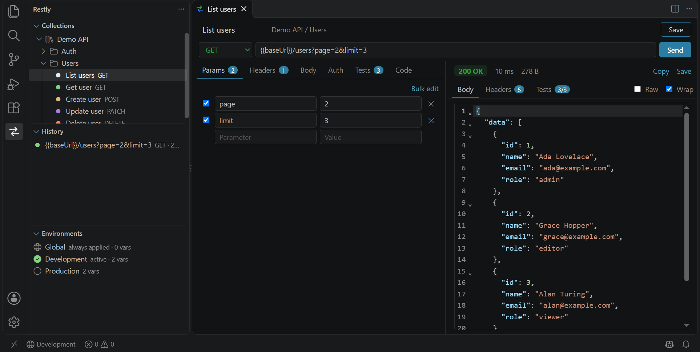

# Restly - REST API Client for VS Code

A free, open-source REST API client that lives in your editor. Build and send
HTTP requests, organise them in collections, switch environments, check
responses with tests and keep everything in git next to your code.

No account, no sign-in, no telemetry, no paid tier. MIT licensed.



## Features

- **Request editor**: any method, query params kept in sync with the URL,
  headers (with bulk edit), and a JSON / text / XML / form URL-encoded /
  multipart (with files) / binary file body.
- **Auth**: Bearer token, Basic, API key in a header or query. A request can
  inherit its collection's auth.
- **Response viewer**: status, time, size and redirect count. The body view
  pretty-prints and highlights JSON, XML and HTML. Images preview inline. You
  also get a headers table and can copy the body or save it to a file.
- **Collections and folders**: create, rename, duplicate, delete and export
  from the sidebar.
- **Environments**: `{{variables}}` everywhere (URL, params, headers, body and
  auth). Dynamic values: `{{$guid}}`, `{{$timestamp}}`, `{{$isoTimestamp}}`
  and `{{$randomInt}}`. **Secret** variables are kept in VS Code's secret
  storage, never in your repo.
- **Tests**: check the status, a header, a JSON path, the body text or the
  response time. **Set env var** stores a value from the response (a login
  token, say) for the next request.
- **History**: every sent request, one click to reopen.
- **Import**: paste a cURL command into the URL bar, or import from the
  clipboard or a file. Supported files are Postman collections (v2.0 / v2.1),
  Postman environments and Restly exports.
- **Code snippets**: cURL, JavaScript `fetch`, `axios` and Python `requests`,
  with variables filled in.
- Follows your VS Code theme and proxy settings.

## Install

Search for **Restly** in the VS Code Extensions view, or install it from the
[Visual Studio Marketplace](https://marketplace.visualstudio.com/items?itemName=talha-noyon.restly):

```sh
code --install-extension talha-noyon.restly
```

Each version is also attached to a
[GitHub Release](https://github.com/Talha-Noyon/restly/releases/latest) as a
`.vsix` file: run `code --install-extension restly-x.y.z.vsix`, or use
**⋯ → Install from VSIX…** in the Extensions view.

## Getting started

1. Open the **Restly** icon in the activity bar.
2. Click **+ New Request**, enter a URL and press **Ctrl+Enter** (Cmd+Enter on
   macOS) or **Send**.
3. Press **Ctrl+S** to save it into a collection.
4. Under **Environments**, create one (for example `Development`) and add
   `baseUrl = https://api.example.com`. Then use `{{baseUrl}}/users` in your
   requests. The active environment is shown in the status bar; click it to
   switch.

### Login flow with tests

On your login request, add a test row:

| Target    | Path           | Operation     | Value   |
| --------- | -------------- | ------------- | ------- |
| JSON body | `$.data.token` | set env var   | `token` |

Then set other requests' auth to **Bearer** with token `{{token}}`, or set it
once on the collection and leave requests on **Inherit**.

## Where data is stored

| What                       | Where                                                                  |
| -------------------------- | ---------------------------------------------------------------------- |
| Collections                | `.restly/collections/<name>.json` in the workspace (default)           |
| Environments               | `.restly/environments/<name>.json` in the workspace (default)          |
| Secret variable values     | VS Code SecretStorage (OS keychain), never on disk with the rest        |
| History                    | VS Code global storage, per user                                        |

Set `restly.storage` to `global` to keep collections and environments in VS
Code's global storage instead, shared by every window. Without an open folder
Restly always uses global storage.

Each collection is a separate, pretty-printed JSON file, so diffs and merges
stay readable. Restly reloads the sidebar when those files change, for example
after a `git pull`.

Variable lookup order: **active environment → collection variables → Global**.

## Settings

| Setting                  | Default     | Description                                   |
| ------------------------ | ----------- | --------------------------------------------- |
| `restly.storage`         | `workspace` | `workspace` (`.restly/` folder) or `global`   |
| `restly.timeout`         | `30000`     | Request timeout in ms; `0` disables it        |
| `restly.followRedirects` | `true`      | Follow HTTP redirects                          |
| `restly.maxRedirects`    | `10`        | Redirect limit                                 |
| `restly.strictSSL`       | `true`      | Turn off to accept self-signed certificates    |
| `restly.historyLimit`    | `500`       | Number of history entries kept                 |

## Development

```sh
npm install
npm run build      # bundles dist/extension.js and dist/webview.js
npm test           # vitest
npm run typecheck
npm run lint
npm run package    # builds restly-<version>.vsix
```

Press **F5** in VS Code to start an Extension Development Host with Restly
loaded.

Layout:

```
src/shared/      pure logic: model, variables, cURL/Postman import, codegen, tests
src/extension/   extension host: HTTP client, storage, sidebar trees, panels
src/webview/     request and environment editors (Preact + CodeMirror)
test/            vitest suites, including the HTTP client against a local server
```

## Releasing

1. Bump `version` in `package.json` and add a `CHANGELOG.md` entry; commit and push.
2. Publish a GitHub release tagged `vX.Y.Z`.

The `Release` workflow then builds the `.vsix`, attaches it to the release and
publishes it to the VS Code Marketplace with
[Trusted Publishing](https://code.visualstudio.com/api/working-with-extensions/publishing-extension)
(`vsce publish --oidc`), so no Marketplace token is stored anywhere. It needs a
Trusted Publishing policy on the `talha-noyon` publisher for repository
`Talha-Noyon/restly` and workflow `release.yml`. Running the workflow by hand
(**Actions → Release → Run workflow**) publishes the current `main`.

## License

[MIT](LICENSE)
